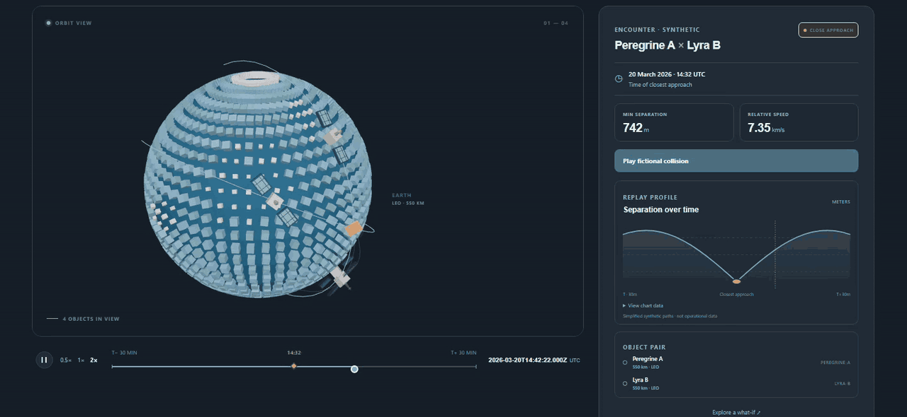
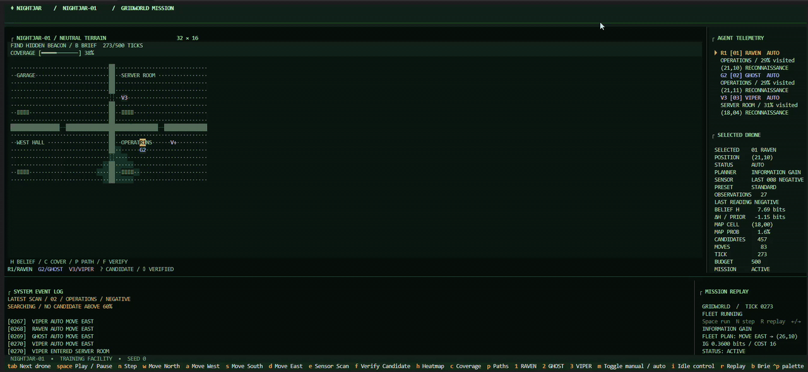

# Kylan

Software Engineering @ University of Ottawa.

[LinkedIn](https://linkedin.com/in/kylan-thurairajah) · [GitHub](https://github.com/Kylan-Thurairajah)

---

### Projects

**[Perigee](https://github.com/Kylan-Thurairajah/Perigee)** `Go` `gRPC` `PostgreSQL` `TypeScript`  
Orbital collision screening engine. Parallel orbit propagation, spatial indexing, and conjunction detection across large satellite catalogs. Includes a web-based 3D viewer.

**[Nightjar](https://github.com/Kylan-Thurairajah/nightjar)** `Python` `NumPy` `Textual`  
Multi-agent search simulator with autonomous exploration, shared environment knowledge, and a terminal-based interface for inspecting agent behavior.

**[CueVision](https://github.com/Kylan-Thurairajah/CueVision)** `Computer Vision` `Edge Computing`  
Edge-to-cloud vision platform connecting wearable devices, vision processing workers, and cloud services through asynchronous pipelines.

**[Lexica](https://github.com/tanishboiiii/Lexica---ChatGPT-Search-Engine)** `Python` `FastAPI` `FAISS` `BM25`  
Local search engine for ChatGPT conversations. Combines keyword and vector search to retrieve relevant conversations without relying on exact matches.

---

### Stack

**Languages:** Go, Python, TypeScript, Java, C, SQL  
**Backend & Data:** FastAPI, Spring Boot, PostgreSQL, Redis, gRPC, ZeroMQ  
**Tools:** AWS, Docker, GitHub Actions, Linux
